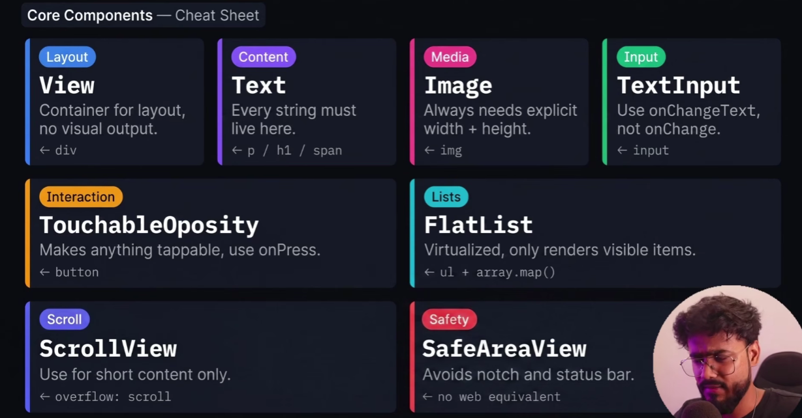
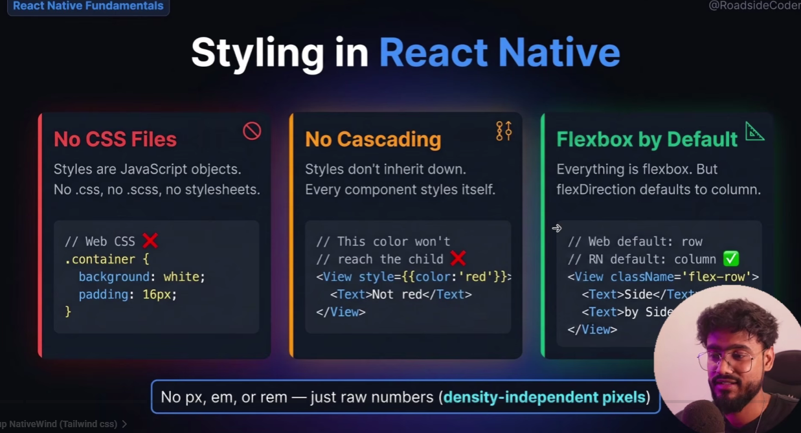
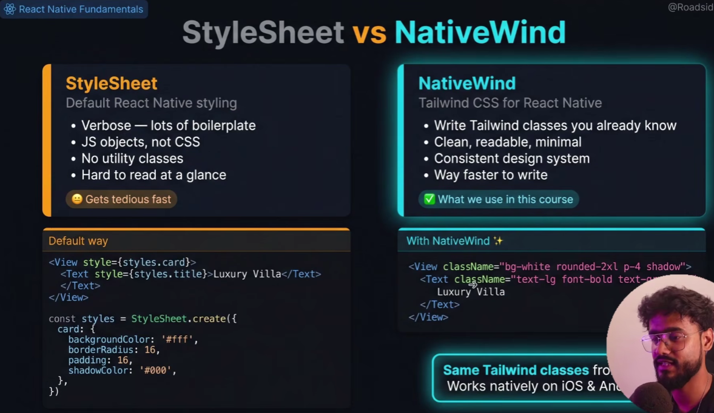
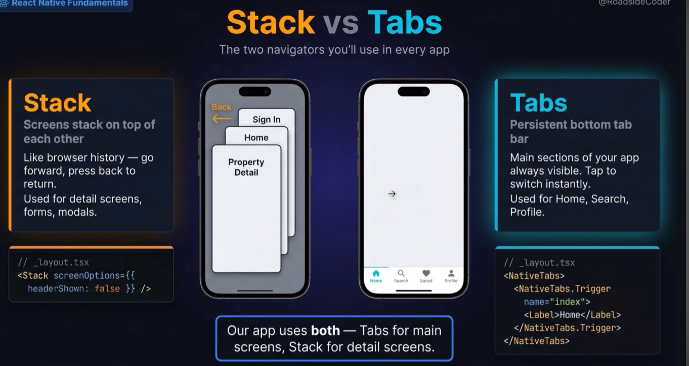
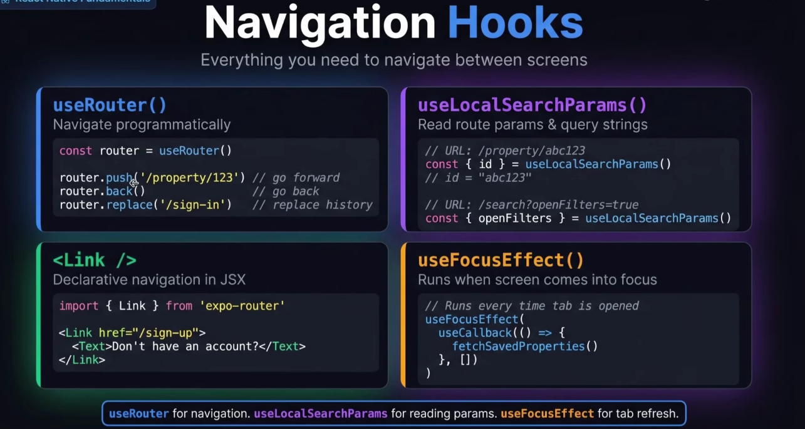
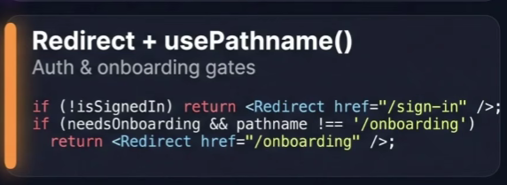
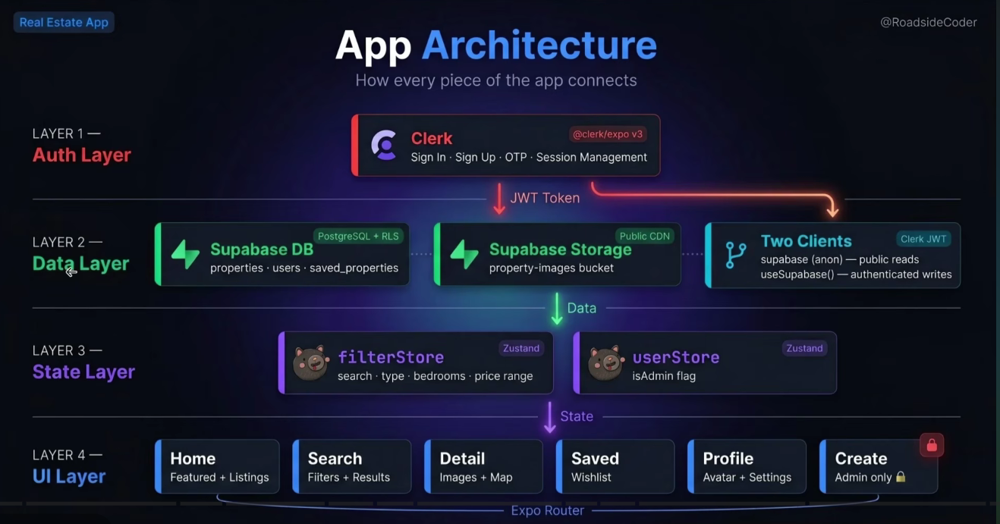
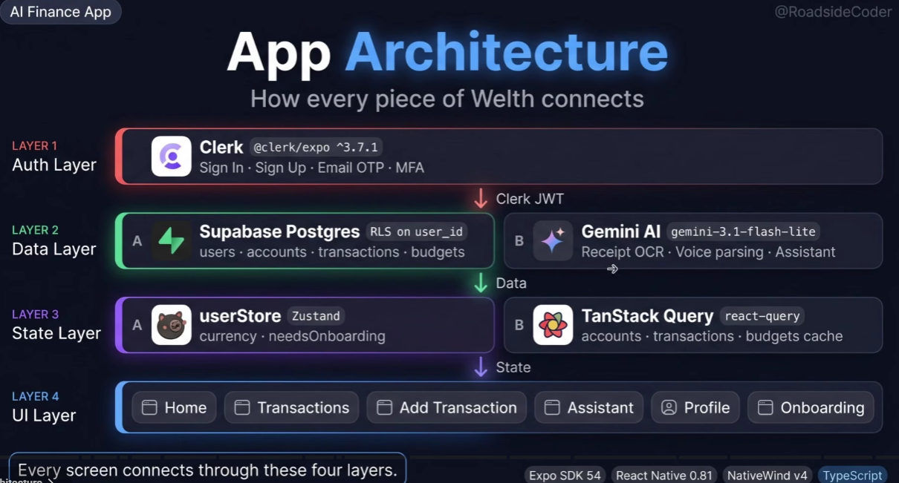
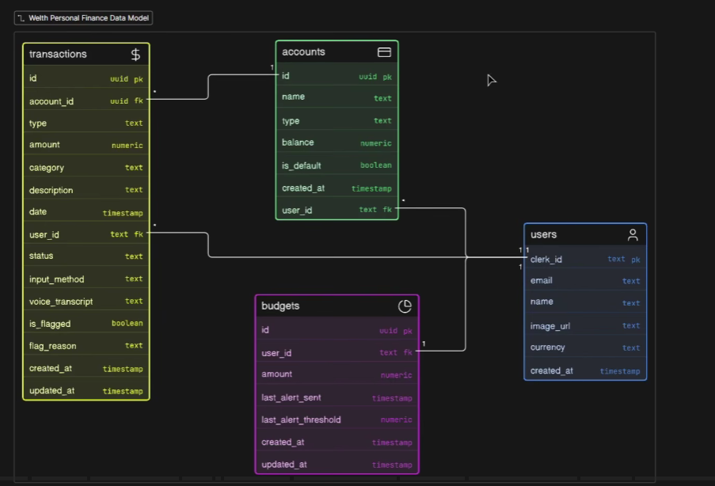

# React Native Notes

npx expo start --tunnel --clear  
needs to build the app in expo again after making changes to packages, or new route added

## *This one is for the property listing one*  

## *Actual one*  

The auth pages are Stack navigation and the main app is a Tab navigation.  
We are using Link from expo-router to navigate between the two.  

## Doubts

supabase and clerk connection  
third party auth provider  
jwt token from clerk  

> creating custom hooks  

rls  
zustand  
pagination  

## Check later  

all useQuery - tanstack shit  
   hooks/query, hooks/mutations, lib/query, lib/services  

the whole add-transaction flow  
the voice transaction whole flow, account type is not added  
